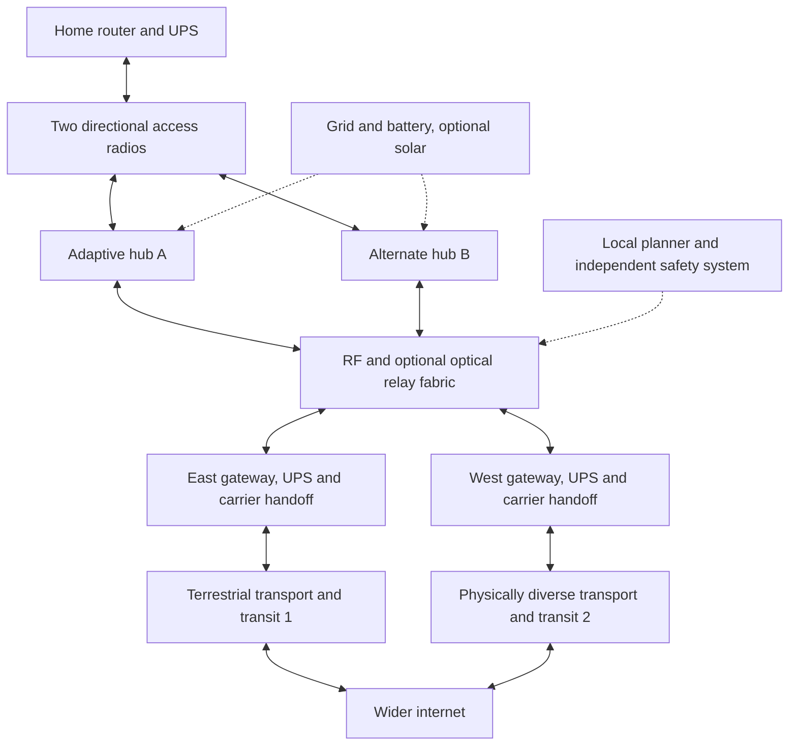

# Auren design specification

Revision 0.1, 2026-10-14. Experimental proposal. Classification: established precedents + original integration hypothesis. No measured Auren field results.

## Objective and scope

Provide useful residential broadband without satellites, launches, or satellite backhaul. Aim for modular repair, inexpensive manufacturing, reusable deployment and five-year cost at or below 25% of comparable purchased Starlink service. This is a testable target, not a current capability.

The first commercial market is a clustered, open rural community near two diverse terrestrial internet handoffs. Mobile corridors, maritime, aviation and global coverage have separate requirements and are not silently treated as equivalent to this market.

## Physical contribution

Conventional networks generally build permanent geometry, then route packets through it. Auren proposes treating relay height, location and orientation as controllable resources. A base-assembled, locked truss is raised by alternating lifting collars. Instrumented guy reels maintain tension during deployment. An independent carriage brings radio/optical equipment down for repair.

The proposed new combination is: low-cost reusable mechanical structure + ground-level equipment exchange + capacity-aware physical handover + admission based on measured qualified customers. This is not a claim that self-erecting towers, optical backhaul, meshes or resilient routing are new. No comprehensive patent search or freedom-to-operate analysis has been performed.

## Full internet path

Two carrier contracts do not imply physically independent ducts, buildings, power or flood exposure. Survey and contractual evidence must establish diversity. Both upstream paths failing means no wider internet, regardless of local mesh health.

## Components and boundaries

- CPE: preconfigured directional radios, indoor router and small UPS. Two antennas provide geometrically distinct access; a single narrow beam cannot aim at arbitrary backup sites.
- Hub: locked adaptive structure, independent lowering carriage, three directional sectors, backbone interfaces, battery/DC supply, sensors and local diagnostics.
- Fabric: routed RF/optical links with explicit directional throughput and weather state. Avoid a network-wide bridged broadcast domain.
- Gateways: terrestrial resale-permitted service, public addressing/IPv6 plan, shaping, routing, DNS and outage handling.
- Operations: paid support and field work, spare cartridges, recorded maintenance and storm inspections.
- Website: static documentation and browser-local calculations. Not a network control portal, SaaS service or customer-data database.

## Candidate architecture review

| Candidate | Mechanism/path | Established | Hypothesis/advantage | Dominant failure |
| --- | --- | --- | --- | --- |
| Shared utility fiber | Drop -> permitted duct/pole/corridor fiber -> carrier | PON and fiber infrastructure sharing | Removable installation cartridges and automated survey | Civil work and rights-of-way; ordinary fiber may already be best |
| Ground WISP/mesh | Dish -> roof/ridge hub -> directional backbone -> fiber | Commercial WISPs, NYC Mesh | Automated bidirectional admission and repair package | Terrain, foliage, interference, labor |
| Passive RF reflector | Village radio -> ridge reflector -> gateway | Passive microwave repeaters | Adjustable mass-produced panels and alignment | Two-leg link losses, very large apertures |
| Tethered platform | CPE -> aerostat/kite/drone -> tether -> ground backhaul | Aerostar and tethered radio systems | Interchangeable lifting surfaces, docking and ground handover | Wind, icing, safety, gas or propulsion, staffing |
| Free balloons | User -> balloon -> balloon network -> gateway | Loon | Cheap recovery and drift-tolerant scheduling | Replenishment and coverage surplus; Loon economics failed |
| HAPS | User -> aircraft/airship -> optical peers -> gateway | Airbus, Sceye, solar HAPS | Separate access from transport, shared recovery cover | Power, winter, station-keeping, approvals, cost |
| Auren | CPE -> movable-height hub -> hybrid fabric -> two gateways | All individual technology classes have precedents | Physical geometry and maintenance coordinated with routing | Mechanism lifecycle cost may exceed avoided construction/climbing |

## Global equivalence

Ground coverage is not global equivalence. At a 5 km ideal radius, land-area coverage alone needs roughly 1.9 million sites before overlap, terrain, reserve and capacity. Oceans are not economically covered by this layer.

The strongest extension is customer -> stratospheric access platform -> optical inter-HAPS relays -> multiple terrestrial gateways -> terrestrial/submarine fiber -> internet. Still satellite-free, but not built here.

At 20 km altitude the geometric horizon is roughly 505 km, not a practical broadband service radius. A 100 km ideal radius over the entire 510 million km² Earth surface implies at least 16,234 platforms by area; practical overlap/spares/traffic could require 20,000–30,000 or more. This is an order-of-magnitude scenario, not a deployment plan.

At 1 Gbps usable access, 4 Mbps busy-hour average and 20% reserve, one platform supports about 200 customers. A hypothetical $700,000 five-year platform/operations budget costs $3,500/customer before CPE or gateways. To allocate only $500/customer to the platform needs <=$100,000 five-year cost at that capacity or substantially greater capacity per dollar/watt.

A 1 kW airborne load during a 13-hour night requires approximately 18 kWh storage at 80% depth and 90% conversion, or 60 kg at an assumed pack-level 300 Wh/kg. A 4 kW load quadruples this. Polar winter is not closed by ordinary solar/battery cycling. Wind-assisted flight is a measured-resource research question, with NASA prior art, not perpetual free energy.

Binding constraints: persistent platform cost, capacity per watt, low utilization over oceans/sparse regions, licensing, aviation approvals and correlated weather. No physics proof rules out a future global system; no current evidence proves the quarter-cost global objective either.

## Precedents

See [source register](SOURCES.md): NYC Mesh routing; Loon commercial lessons; Aerostar elevated communications; Airbus/DOCOMO experiments; Sceye 2026 endurance; Taara optical links; NASA/MIT deployable towers. Lunar tower performance cannot be transferred to Earth wind/gravity without qualification.
