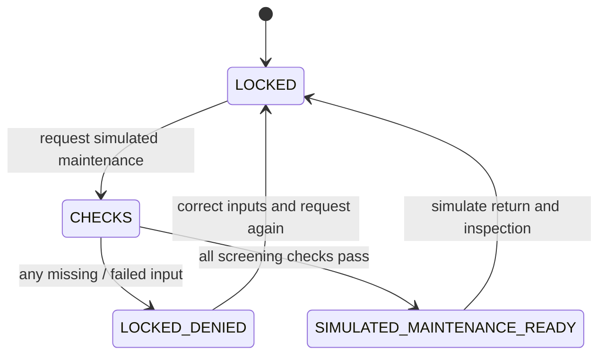

# Controller and safety boundary

The software is **SIMULATION_ONLY**. It contains no GPIO, PLC, serial, radio-management, motor-driver or physical actuator adapter. A successful plan does not authorize movement of real equipment. This is not a certified safety system.

## State model

Planner gates in `src/controller.mjs`:

- Explicit structural and operator approval flags. Browser flags are fictitious approvals, not signatures or certification.
- No asserted or unknown emergency stop.
- Finite clock and telemetry, not older than 5 seconds or from the future.
- Confirmed locks and anchors.
- Simulated movement wind <=8 m/s and energy reserve >=2 hours. These are conservative illustrative inputs, not qualified operating limits.
- All admitted down/up demand preserved through explicit relocation.
- No invented fallback links, carrier capacity or changed link status.
- After the maintenance target is removed, fallback can carry demand with 20% reserve and survive an additional tested link/carrier-domain failure.

Unknown is unsafe. A failed hub never makes its customers disappear from demand accounting. Ground traffic continuity is not a structural clearance, and structural approval is not an internet-capacity result.

## Unimplemented physical requirements

Independent safety circuitry, redundant restraint, interlocked collar design, lock/load sensing, tension bounds, limit switches, brake monitoring, exclusion zones, qualified operating procedures, commissioning signatures, software/hardware integrity review, recovery plans and physical safety certification remain future work. Do not attach the prototype planner to hardware.

## Network and web boundaries

The topology is synthetic and the website is read-only. No customer logins, form submission endpoint, device-management routes, stored leads, payment collection or telemetry feed exists. Inputs are local browser state. Deployment credentials must remain outside Git and the public build.

Future device administration must be isolated, authenticated and least-privilege. A public marketing site must never share direct actuator authority. Hardware interfaces require separate review and explicit commissioning.

## Reporting

Do not publish passwords, private addresses, precise critical-infrastructure details or customer data in GitHub issues. Report sensitive concerns to support@dyadic.app. There is no claim of a completed security audit or functional-safety certification.
